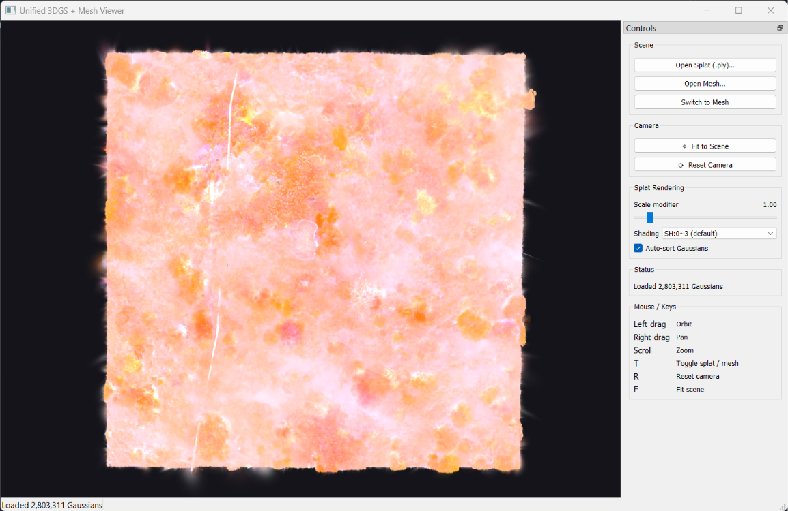

# pyvista-gs

PyVista-backed 3D Gaussian Splatting viewer packaged as an installable Python
module. `GaussianActor` is the main reusable integration point: it can be
embedded in other PyVista or Qt applications and behaves like a first-class VTK
actor from the outside, with full support for picking, bounding-box queries, and
scene composition alongside meshes and point clouds.

Originally forked from
[limacv/GaussianSplattingViewer](https://github.com/limacv/GaussianSplattingViewer).



## Architecture

pyvista-gs uses a **single-pass VTK-native** rendering architecture. A
`GaussianActor` is a true `vtkActor` that participates fully in VTK's scene
graph:

```
GaussianActor (vtkActor)
├── vtkPolyData: one vertex per Gaussian centre
├── Geometry shader: reads attributes from SSBOs
│   ├── Covariance projection (3D→2D splatting)
│   ├── Spherical Harmonics color evaluation (bands 0–3)
│   └── Emits billboard quads sized for correct coverage
├── Fragment shader: Gaussian falloff + alpha blending
└── Rendered in VTK's opaque pass (not translucent OIT)
    ├── Receives scene depth via depth test
    ├── Composites correctly with scene geometry
    └── Participates in picking and bounding-box queries
```

**Why single-pass?** The key insight was that VTK's **translucent pass uses
Order-Independent Transparency (OIT) with an accumulation buffer**, which
clobbered per-draw blend-state overrides. Moving the actor to the **opaque
pass** (via `ForceOpaqueOn()`) gives direct control of blend state. With
correct `SRC_ALPHA, ONE_MINUS_SRC_ALPHA` blending applied before the draw, the
Spherical Harmonics evaluation now produces correct (non-blown-out) colors
**in the geometry shader**, matching the working ModernGL implementation
exactly. This eliminated the need for a hybrid workaround.

### Rendering Pipeline

1. **Per-frame depth sort**: Gaussians sorted back-to-front by camera position
2. **GPU SSBO upload**: Position, rotation, scale, opacity, and SH coefficients
   transferred to device-side shader storage buffers
3. **Geometry shader rasterization**: One point per Gaussian → four-vertex
   billboard quad, with covariance-based sizing and SH color lookup
4. **Fragment shader alpha blending**: Gaussian falloff mask, alpha-blended
   composite into scene framebuffer
5. **VTK scene integration**: Full depth testing, picking support, and
   compositing with other VTK actors

## Install

```bash
pip install -e .
# if/when published to PyPI:
# pip install pyvista-gs
```

## Run

```bash
pyvista-gs
python -m pyvista_gs
python -m pyvista_gs --hidpi    # larger UI font (14 pt) on HiDPI displays
```

## Usage

Use `GaussianActor` to add 3D Gaussian splats to an existing PyVista
application:

```python
import pyvista as pv
from pyvista_gs import GaussianActor, load_ply

plotter = pv.Plotter()
gaussians = load_ply("/path/to/point_cloud.ply")
actor = GaussianActor(gaussians)
actor.bind_to_plotter(plotter)  # adds the splat actor to plotter.renderer
plotter.show()
```

`bind_to_plotter()` creates the GPU renderer and adds the `vtkActor` to the
scene, so don't call `plotter.add_actor()` yourself. The raw VTK actor is
available as `actor.actor` once bound. You need an OpenGL 4.3+ context because
the renderer uses geometry shaders and SSBOs.

### Features

- **Crop** — `set_crop_bounds(bounds)` stores `(xmin, xmax, ymin, ymax, zmin,
  zmax)` bounds. `apply_crop_box()` permanently removes splats outside them, and
  `clear_crop_box()` discards them. Rendering isn't clipped until you apply.
- **Transform** — `transform(matrix)` applies a 4×4 homogeneous transform to
  positions, rotations, and scales.
- **Floater removal** — `remove_floaters(min_opacity, max_scale)` culls noisy
  splats that are too transparent or too large.
- **Tinting** — `tint_gaussians(indices, color_rgb, blend_factor=0.6)` blends
  a 0–255 RGB color into the DC spherical harmonic coefficients of the selected
  splats. `reset_colors()` restores the original colors.
- **Picking** — `pick_gaussian(ray_origin, ray_dir, fovy_rad, window_height)`
  estimates on the CPU the world-space surface point under a view ray, using
  an opacity-weighted depth of nearby Gaussian centres. It returns a point on
  the ray, not a splat index.

### Embedding

For the full standalone window, use `from pyvista_gs import MainWindow`. For the
Qt sidebar, use `from pyvista_gs.ui import ControlPanel`. It expects a
`MainWindow`-like object as its first argument.

### GPU sorting

Optional CUDA sorting backends (`torch` or `cupy`) are detected at runtime and
used automatically when installed. Falls back to NumPy CPU sorting otherwise.

## The Crux: Solving "Blown-Out SH" in VTK's Geometry Shader

The original architecture was a hybrid VTK + ModernGL workaround due to
SH color evaluation producing blown-out results in VTK's geometry shader. After
systematic debugging, the root cause was identified:

**The Problem:** VTK's **translucent pass** (used for alpha-blended geometry)
employs **Order-Independent Transparency (OIT)** with a multi-pass accumulation
buffer scheme. Per-draw blend-function overrides are ineffective in OIT because
the actual framebuffer draw happens during a later composite pass, not during
your callback. The actor saw `ONE, ONE` (additive) blending from VTK's OIT
setup, which summed splat colors to white, masking the real (dim) SH-evaluated
colors underneath.

**The Solution:** Render in VTK's **opaque pass** via `ForceOpaqueOn()`. The
opaque pass does a single, straightforward draw with no accumulation — the blend
state you set **sticks** and is used directly. Switching from additive to
`SRC_ALPHA, ONE_MINUS_SRC_ALPHA` (standard translucency) revealed that the SH
math was correct all along; the geometry shader implementation is byte-identical
to the working vertex shader version.

**Key Insight:** The issue was not precision, not matrix conventions, not data,
and not the SH coefficients. It was **VTK's rendering pass selection**. Once
that was fixed, the single-pass actor worked perfectly.